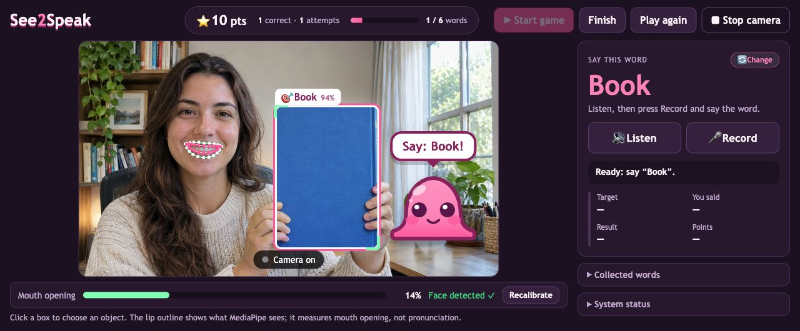

# See2Speak

See2Speak is a webcam-based English vocabulary game. Show an object, listen to its name, then say the word to earn points. The browser sends camera frames and recordings to a local Python server for inference.

The game supports **Book, Cell phone, Apple, Pen, Water bottle, and Scissors**.



*Example gameplay with a staged camera feed and score. MediaPipe detected the lip landmarks in the staged frame.*

## Quick start

You’ll need Python 3.11 (the repository default), a webcam, a microphone, a modern browser, and an internet connection for the first model download.

1. From the project root, create a virtual environment. Use either setup method throughout.

   | Method | Command |
   | --- | --- |
   | Python `venv` + `pip` | `python -m venv .venv` |
   | `uv` (if installed) | `uv venv --python 3.11 .venv` |

2. Activate it with the command for your shell.

   | Shell | Command |
   | --- | --- |
   | macOS or Linux | `source .venv/bin/activate` |
   | Windows PowerShell | `& .\.venv\Scripts\Activate.ps1` |

3. Install dependencies using the same method.

   | Method | Command |
   | --- | --- |
   | Python `venv` + `pip` | `python -m pip install -r requirements.txt` |
   | `uv` | `uv pip install -r requirements.txt` |

4. Prepare the models and start the app.

   ```sh
   python scripts/download_models.py
   python run.py
   ```

The launcher opens [http://localhost:8000](http://localhost:8000). Use that address if the browser doesn’t open automatically. Models load in the background and the system panel shows when they’re ready. Press **Ctrl+C** in the terminal to stop the server.

## How to play

1. Select **Start game** and allow camera access. When prompted, relax your mouth to calibrate the optional movement feedback, or select **Skip**.
2. Hold up a supported object. The game selects a target after two sightings, or you can click a detection box to choose one yourself. The selected word stays active even if its box disappears. Select **Change** to clear it and look for another object.
3. Select **Listen** to hear the word, then **Record** and say it. Allow microphone access when prompted. Select **Stop recording** to submit the clip early, or let the recording end automatically.
4. A correct answer earns **10 points** the first time you get that word right in the session. Accepted aliases count as correct. Near matches get feedback and earn zero points. Select **Finish** to see your score and session history.

Mouth-movement feedback uses webcam landmarks and is separate from scoring. Points depend on the transcript matching the selected word.

### Accepted spoken answers

| Object | What you can say |
| --- | --- |
| Book | book |
| Cell phone | cell phone, cellphone, phone, mobile phone, mobile |
| Apple | apple |
| Pen | pen |
| Water bottle | water bottle, bottle, flask, water flask |
| Scissors | scissors, scissor |

A leading “a”, “an”, or “the” is optional. For example, “an apple” counts as “apple”.

## How it works

| Part | Role |
| --- | --- |
| [Browser interface](frontend/) | Captures camera frames and audio, draws boxes, selects the practice target, and displays feedback. |
| [FastAPI server](backend/main.py) | Serves the browser interface and handles detection, calibration, spoken attempts, and sessions. |
| [YOLO-World](backend/detection.py) | Detects objects using text prompts for each vocabulary entry. |
| [Whisper](backend/speech_recognition.py) | Transcribes recordings locally. The default model is `base.en`. |
| [MediaPipe Face Landmarker](backend/facial_landmarks.py) | Tracks lip landmarks and estimates movement relative to a relaxed-mouth baseline. |
| [Game logic](backend/game_logic.py) | Normalizes and matches transcripts, awards points, and stores attempts and scores in `data/see2speak.sqlite3`. |

[Configuration](backend/config.py) defines the vocabulary, detection prompts, accepted answers, scoring rules, and model thresholds. The downloader puts detector and face-landmarker assets in `models/` and prepares the Whisper cache. Model files and runtime data are excluded from Git.

### Options

| To do this | Run |
| --- | --- |
| Start without opening a browser | `python run.py --no-browser` |
| Use another port | `python run.py --port 8080` |
| Use the smaller Whisper model | `python run.py --whisper tiny.en` |
| Set the global detection confidence threshold | `python run.py --min-conf 0.85` |
| Start FastAPI directly after preparing the models | `python -m uvicorn backend.main:app --host 127.0.0.1 --port 8000` |

For custom pronunciation audio, place MP3 files in [`frontend/assets/audio/`](frontend/assets/audio/) using the vocabulary key as the filename, such as `book.mp3` or `cell_phone.mp3`. The browser uses speech synthesis if the file is missing.

## Interactive benchmarks

Run these from the project root in the same virtual environment. They open desktop OpenCV windows and use the webcam or microphone directly. They run independently of the browser game, print summaries to the terminal, and save screenshots under `docs/screenshots/`.

| Benchmark | Command | What it measures |
| --- | --- | --- |
| Object detection | `python scripts/evaluate_system.py --trials 10` | Precision, recall, F1, hit rate, confidence, and latency on timed webcam captures. A negative-control phase measures how often the detector correctly returns no boxes. |
| Target locking | `python scripts/evaluate_locking.py --trials 10` | Mean, minimum, and maximum lock times, plus the percentage of completed trials that lock within 3 seconds. |
| Speech recognition | `python scripts/evaluate_speech.py --trials 10` | Expected decision vs. actual decision and average transcription time for exact answers, aliases, near matches, wrong words, and silence or noise. |
| Facial landmarks | `python scripts/evaluate_face.py` | Neutral-mouth calibration time, movement during speech vs. at rest, and lip closure at the start of words beginning with **B** or **P**. |
| Whisper vocabulary hint | `python scripts/evaluate_whisper_hint.py --speaker S1 --reps 2` | Transcribes each recording twice, with and without the vocabulary hint, and compares the resulting decisions. |

- **Target locking.** The stopwatch starts when you select **Start Trial** and stops when the second qualifying detection locks the target. If more than **500 ms** passes after the first hit, the next detection starts a new pair while the stopwatch keeps running.
- **Object detection.** Use `--interval` to change the delay between captures from its default of 2 seconds.
- **Whisper vocabulary hint.** Recordings are saved in `data/hint_ablation/`. Pass `--analyse` to analyze the saved WAV files again without recording new ones.

## Troubleshooting

| Problem | What to check |
| --- | --- |
| The page doesn’t load | Make sure `python run.py` is still running and open the localhost address for the port you chose. |
| The browser can’t access the camera or microphone | Open the game through localhost, grant browser permissions, and close other apps using the device. |
| A desktop benchmark can’t open the camera | Grant camera access to the terminal or app that launched it. The error reports the camera index it tried. |
| A desktop benchmark can’t open a window | Check that your OpenCV build includes desktop GUI support. |
| A model fails to load | Check the system panel for the error and rerun `python scripts/download_models.py` with internet access. |
| An object is missed repeatedly | Use even lighting, hold the object steady, and move it closer to the camera. |
| Speech recognition is slow | Try `python run.py --whisper tiny.en`. |
